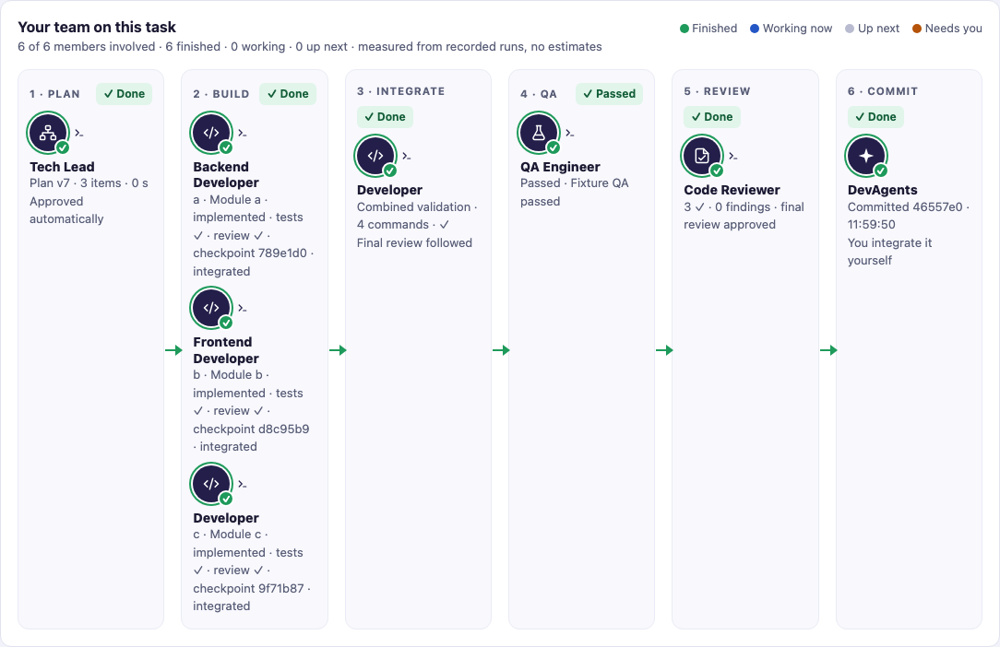

<h1 align="center">✦ DevAgents</h1>

<p align="center"><strong>An AI development team for your local Git projects.</strong></p>

<p align="center">
  <a href="#quickstart">Quickstart</a> ·
  <a href="#features">Features</a> ·
  <a href="docs/SETUP.md">Setup</a> ·
  <a href="docs/REFERENCE.md">Documentation</a> ·
  <a href="docs/MILESTONES.md">Roadmap</a>
</p>

DevAgents coordinates agents that plan changes, write code, run checks, and independently review the result. Give a team a task, follow its work in your browser, and inspect the final diff and local commit.

Choose each member's role, coding engine, and model. DevAgents handles delegation, isolated worktrees, integration, and bounded repair loops while keeping the plan, execution history, and validation evidence together.

## Quickstart

**Requires:** Git and Docker with Compose on macOS or desktop Linux. Linux also needs `openssl`, `secret-tool`, and an unlocked desktop keyring. No host Node.js installation is needed for Docker.

```sh
git clone https://github.com/sargis-hakobyan/devagents.git
cd devagents
./devagents start
```

Choose **Browser** for guided setup, or **Terminal** to configure from the command line. The first start builds the local image; later starts reuse it or rebuild when the source changes.

1. **Connect an engine.** Sign in to Codex with ChatGPT or an OpenAI API key. For Claude, follow [Claude setup](docs/SETUP.md#claude).
2. **Add a project.** Choose an existing local Git repository. In Docker, the browser prepares a command for mounting and registering the folder through the local launcher.
3. **Submit work.** Use the starter team, describe the change and expected outcome in the task description. Choose plan approval to review the proposed change, planned checks, and risks in plain language before implementation begins. File paths and commands are available under **Technical details**.

Saved connections are reused. Run `./devagents setup` to change setup later. See [setup and troubleshooting](docs/SETUP.md) or the [native installation guide](docs/REFERENCE.md#native-quickstart) for other options.

## Your team, from request to reviewed code

The starter team includes a **Tech Lead**, **Frontend Developer**, **Backend Developer**, and **Code Reviewer**. Customize their instructions, engines, and models in Teams.

| Step | What happens |
| --- | --- |
| **Plan** | The Tech Lead inspects the project, defines contracts, and assigns focused tasks to available specialists. |
| **Build** | Developers work in isolated worktrees. Independent items can run in parallel; genuine dependencies wait. |
| **Verify and review** | Changes are integrated, project checks run, and an independent reviewer reports defects. Assigned developers repair them before fresh validation and review. |
| **Inspect the result** | Open the diff, check the evidence and limitations, and take the resulting local commit into your own workflow. |

<p align="center">
  
</p>
<p align="center"><sub>Deterministic demo with optional QA enabled. Separate agent QA is off by default.</sub></p>

## Features

| | What you get |
| --- | --- |
| **Configurable teams** | Reusable roles, instructions, permissions, and per-member engine/model choices. Each submitted task keeps a frozen team snapshot. |
| **Parallel development** | Dependency-aware work assignment, isolated Git worktrees, and an explicitly assigned integration owner. |
| **Visible execution** | A browser timeline of agent runs, parallel work, automated checks, reviewer findings, and repair attempts. |
| **Quality gates** | Developer validation and independent, read-only code review. Optional QA verifies acceptance criteria. |
| **Usage tracking** | Reported tokens by step and attempt. Available cost estimates are labelled; missing data stays unavailable. |
| **Local results** | Read-only diffs, local branches and commits, persistent task history, and automatic cleanup with recovery snapshots for unfinished work. |

## Coding engines

| Engine | Current status |
| --- | --- |
| **Codex** | Implemented; authenticated execution has been verified. Connect through ChatGPT sign-in or an OpenAI API key. |
| **Claude** | Implemented with deterministic adapter and UI checks. Authenticated execution and account model access remain unverified. See [connection options and limits](docs/SETUP.md#claude). |
| **Local models** | Planned; no execution adapter yet. |

Model choices do not guarantee account access or quota. DevAgents stores task state locally; configured coding engines communicate with their model providers.

## Execution boundaries

- **Work starts from local `main`.** Each task gets a clean worktree and its own branch. Uncommitted changes and other branches are not copied. DevAgents never automatically merges into your checkout or pushes results.
- **The engine sandbox stays active.** Optional extra DevAgents rules are off by default. Docker credentials are encrypted using your OS keychain; project access is explicitly mounted.
- **QA is opt-in.** `qaEnabled: false` keeps separate agent QA disabled. Developer validation and independent review still run. Read the [QA contract](docs/REFERENCE.md#optional-qa-gate) before enabling it.
- **Verification has evidence.** Unavailable optional checks are reported as limitations. A required acceptance criterion blocked at the QA gate prevents a final task commit.

DevAgents currently runs one top-level task at a time, with bounded parallel workers inside it. It is a local, single-user application.

## Documentation

| Guide | Start here for |
| --- | --- |
| [Setup](docs/SETUP.md) | Installation, credentials, projects, environment preparation, and troubleshooting |
| [Technical reference](docs/REFERENCE.md) | CLI commands, configuration, security, usage estimates, and storage recovery |
| [Decisions](docs/DECISIONS.md) | Architectural choices and their rationale |
| [Milestones](docs/MILESTONES.md) | Implemented capabilities, verification history, and planned work |
| [Contributor instructions](AGENTS.md) | Repository conventions and development rules |

## Development

Uses TypeScript, Mastra workflows, SQLite, and a Preact/Vite UI. Requires **Node.js 24.x** and **npm**.

```sh
npm ci
npm run check
```

The standard checks cover backend/UI types, tests, and builds. Browser tests run separately with `npm run test:ui` and require Playwright Chromium. Default tests use deterministic fixtures; live model tests consume account allowance or API credits. See [validation commands](docs/REFERENCE.md#validation-and-contribution).

## License

[Apache License 2.0](LICENSE).
