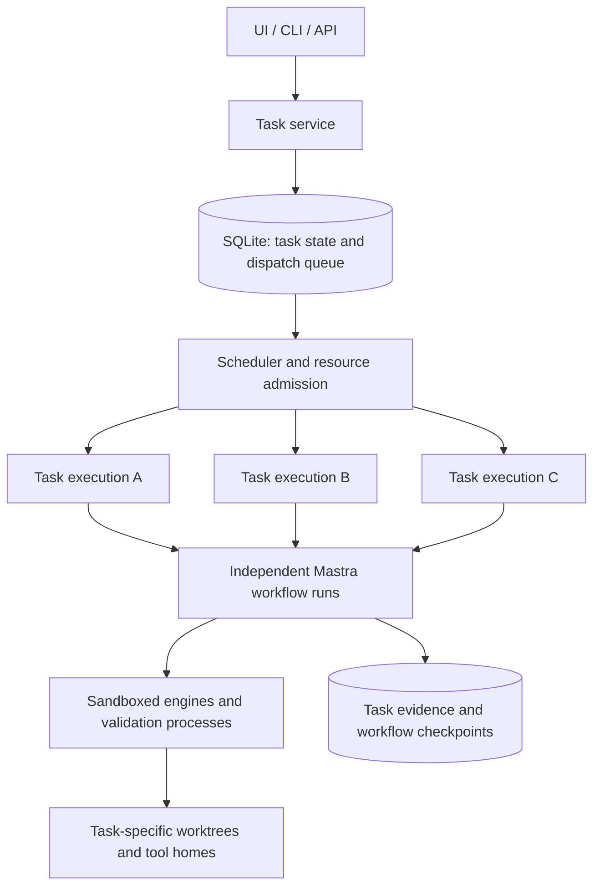

# Parallel task execution plan

Status: the four requested local implementation steps are implemented and verified. Direction agreed on 2026-11-09. Baseline: `8c96ec3`. The sections below record the delivered local design and the separate future AWS scope.

- Step 1: SQLite dispatch storage and serial scheduling implemented. Submission, user mode/approval decisions and cancellation persist dispatch atomically; claims coalesce duplicate requests and retain later continuations.
- Step 2: independent task executions, bounded global operations and preparation reservations implemented; two tasks were verified overlapping in the same repository with separate repair budgets and results.
- Step 3: execution-scoped generation checks, claim heartbeats and conservative startup reconciliation implemented. Uncertain prior workers block automatic cleanup/replay; safe queued work can start after restart.
- Step 4: per-task cancellation/drain, shared Git metadata coordination, scheduler API/CLI/UI visibility and recovery attention implemented. Deterministic tests cover concurrent single-item and DAG tasks, including cancellation and isolated cleanup.

Enable separate tasks to execute concurrently in native and Docker installations, with their own state, worktrees, cancellation and results. Use a durable queue to schedule work and Mastra to execute each task's workflow. Local parallelism must work without AWS. The same execution boundary will support a later distributed AWS deployment.

This local milestone retains DevAgents and the Mastra framework; adopting Mastra Factory is not part of this plan.

## Scope and expected behavior

With capacity for two tasks, A and B execute concurrently while C waits. Finishing A, or suspending A for plan approval, frees capacity for C. Approving A queues a continuation of its existing workflow. Cancelling B stops B's descendants without stopping A or C.

Tasks may target the same repository. Each receives its own branch and worktree from the current local `main`, using the existing ownership rules. They may independently edit the same relative file in their separate checkouts. Each result remains an independently reviewed local commit; results are not automatically combined.

The first release includes:

- Independent execution contexts and bounded scheduling across tasks.
- Durable dispatch requests, atomic ownership claims and duplicate-dispatch protection.
- Shared resource admission, task-specific cancellation and drained cleanup.
- Explicit startup reconciliation, retaining conservative interruption behavior.
- API, CLI and browser visibility of multiple active tasks and queue reasons.
- Deterministic concurrency, failure and security verification.

Later increments cover separate AWS worker containers, distributed storage and ownership, ticket-system connectors, GitHub publication and automatic merging, general hold/resume after failures, and qualification at 100 concurrent tickets. Those capabilities must not be described as delivered by this local concurrency milestone.

## Baseline constraints at 8c96ec3

| Current component | Constraint to address |
| --- | --- |
| `src/orchestration/runner.ts` | One `active` execution; repair count, limitation ledger, attempt counters, preparation state and evidence buffers belong to the shared runner and are cleared by `run()` |
| `src/orchestration/workflows.ts` | Hooks resolve their signal through the single active slot; Mastra already identifies task runs by task ID and tracks hook drain per task |
| `src/orchestration/dag-scheduler.ts` | Concurrency controls work items within one task, not the number of independent tasks |
| `src/persistence/store.ts` | Tasks and evidence are durable; the runner's pending dispatch set is in memory |
| `src/persistence/service-lock.ts` | One service owns a local data directory; retain this protection for the local milestone |
| `src/workspace/git.ts` | Worktree creation is serialized per repository; creation, removal and pruning need a shared concurrency audit |
| `src/workspace/disk-reserve.ts` | One reserve file is manipulated from task execution paths; parallel calls require central coordination |
| UI and service status | Several messages assume one top-level task; active/queued projections must reflect the new scheduler |

## Architecture

The queue determines eligibility and ownership. The scheduler fills available slots. A task execution owns one task's mutable runtime state. Mastra continues to own workflow sequencing, durable approval waits, repair loops and parallel work-item waves. These responsibilities must not become competing workflow engines.

### Independent task executions

The per-task `TaskExecution` object owns the abort controller, repair count, limitation ledger, attempt counters, prepared roster, setup/recovery tracking and evidence buffers. Restore durable facts from the task and evidence when continuing a suspended workflow; never borrow state from another task or silently reset a previously consumed repair budget.

The scheduler keeps an active map keyed by task ID. All workflow callbacks, progress writes, cancellation, drain and finalization resolve through that identity. Share stateless adapters only after auditing their reentrancy; mutable preparers and caches must be task-scoped or explicitly synchronized. Existing run-specific scratch directories and worktree-specific tool homes remain isolated.

Initially these are logical workers in one Node service. Engine and validation commands remain separate sandboxed processes. A second service must still be refused access to the same local data directory. This topology does not claim process-level fault isolation for the orchestrator itself.

### Durable queue

A small queue table in the existing application database stores dispatch requests. No external broker is required for local parallelism. Database state is authoritative; in-memory wake-ups only reduce dispatch latency. A periodic scan and startup reconciliation discover eligible work if a wake-up is missed.

The queue record has one row per task and contains:

- Task ID and dispatch status, separate from the domain task state.
- A monotonically increasing requested sequence and the sequence claimed by the current execution.
- Queue order and the last requested task version for coalescing. Scheduling reasons are derived from task and admission state; delayed retries are not implemented.
- Service-instance owner ID and monotonically increasing claim generation.
- Claim/start/heartbeat timestamps and any recorded recovery blocker.

Schema 5 adds `dispatch_queue` while preserving existing tasks, events, teams and optional schema-4 QA settings.

Create a task and its initial dispatch request in the same transaction. Persist mode selection or version-checked approval and its continuation request atomically as well. Preserve existing submission idempotency: identical retries return the original task and cannot create an additional execution. Coalesce redundant scheduling requests for the same actionable state.

Claim eligible work with one conditional transaction. Never use an unlocked read followed by an unconditional update. Validate the current task state and approved version before launching any engine.

An approval can arrive while a workflow is still persisting suspension. A newer dispatch request must survive completion of an older claimed request. Mark only the claimed sequence handled; re-evaluate a newer sequence after the existing execution has drained. Never dispatch the same task concurrently to resolve this race.

Task rows, queue requests and append-only domain events share an application transaction. Mastra snapshots use separate storage and are not atomically committed with that transaction. Reconciliation must handle both directions of partial completion explicitly, using the persisted task/workflow identity. A queue entry alone never authorizes replay of an execution step.

### Admission and fairness

Configuration implemented in step 2 (restart required):

| Setting | Proposed behavior |
| --- | --- |
| `maxConcurrentTasks` | Default 1 for compatibility; configure 2 to admit two tasks |
| Existing `concurrency` | Retain its work-item-per-task meaning and default 2 |
| `maxConcurrentOperations` | Default 2; service-wide bound on active engine calls, validation commands and dependency-preparation operations |
| Existing member concurrency | Retain per-task frozen member limits; identical role IDs in separate tasks do not accidentally share a member identity |

Acquire a global operation permit only around actual execution, not while a parent workflow waits for a child, approval, or another permit. Release it in `finally` after subprocess drain. Nested phases must not acquire the same permit twice. These limits govern dispatched operations; Docker CPU, memory and PID limits still govern their child processes.

Use FIFO order among eligible dispatch requests, with fair operation admission across active tasks. Approval waits release execution slots. Capacity limits keep tasks queued with a visible reason rather than treating capacity pressure as a code failure. A duplicate request does not move a task ahead of others.

Reserve preparation headroom centrally across task and DAG admissions so concurrent checks cannot each spend the same observed free capacity. Maintain one service-owned disk monitor and emergency reserve coordinator. Reservations are admission estimates, not filesystem quotas; runtime measurements remain necessary. Auth changes and project mount maintenance remain excluded while any relevant work is queued, active or draining.

## Consistency and duplicate-execution contract

The guarantee is one current authorized execution per task and one accepted finalization. The queue's delivery behavior is not the correctness boundary.

1. **Stable identity:** submission idempotency and a unique queue record identify the logical task. Deliberate retries and future ticket revisions are explicit operations, not indistinguishable duplicate messages.
2. **Atomic claim:** only one scheduler claim may launch a task. A completed, cancelled or otherwise ineligible task cannot be restarted by a stale queue entry.
3. **Generation checks:** task mutations and accepted evidence from an execution carry its claim generation. The storage operation checks ownership atomically with the write; a preliminary check alone is insufficient. Keep append-only audit evidence for rejected/stale activity distinct from accepted task output.
4. **Drain before reuse:** the local scheduler never replaces a running context because it is slow or misses a heartbeat. Cancel and confirm descendant drain before releasing its ownership or permitting another context to act on that task.
5. **External effects:** record intent before finalization and reconcile observed Git state after an uncertain result. Reuse the existing reviewed-diff, branch-ownership and commit-intent protections. Database fencing does not itself fence filesystem or Git commands.

Heartbeats report liveness in the first local version. Automatic lease-expiry takeover is deferred to the distributed design. Preserve the single-service lock and prove prior workers stopped before reusing their environment. If that cannot be established, block dispatch and require inspection; do not delete or reuse an environment that may still have a writer.

No architecture here promises that an external model call or command can never repeat after every possible crash. The policy prioritizes avoiding concurrent duplicate work: uncertain executions stop for inspection rather than silently retrying. Future distributed takeover must combine generation checks, worker termination, isolated attempt workspaces and repeat-safe external actions.

## Cancellation, failure and recovery

| Situation | Required behavior |
| --- | --- |
| Cancel a queued task | Persist cancellation and make its dispatch ineligible atomically; no engine starts |
| Cancel an active task | Abort only its context, drain all its descendants, then reconcile and clean up its resources |
| Task-specific setup, validation or review failure | Preserve the task's evidence and result; other tasks continue |
| Storage becomes unreliable | Halt new admission, coordinate stopping active executions, release the emergency reserve once, and expose service health without relying on failed writes |
| Shared disk pressure | Stop new preparation and coordinate affected active work; do not count it as a code repair |
| Graceful shutdown | Stop admission, drain or cancel every active context, persist outcomes, then close shared workflow/database resources |
| Restart with queued work never started | Reconcile the record and dispatch only after proving it is safe to start |
| Restart with a mode/approval wait | Preserve the wait; continue only when the persisted domain decision permits it |
| Restart with work started or an uncertain commit | Inspect task/workflow state and Git evidence; retain conservative interruption/failure behavior, never replay blindly |

The first milestone does not add a general resume action for failed tasks. Existing failed-task inspection/resubmission remains available. Docker compute admission waits for the launcher to restore both encrypted vaults; a failed startup reconciliation halts admission instead of releasing pending work. A queue recovery blocker must be visible as needing attention even if no new domain lifecycle state is introduced. Full product-level “on hold, user resolves, resume” remains a later workflow increment.

Cleanup retains its task maintenance lease and ownership checks. It runs only after that task is drained, without touching another task's worktree, branches, caches, scratch or history. Serialize conflicting Git metadata operations per repository with short locks; never hold those locks throughout model calls or validation. Preserve dirty original checkouts and final result branches.

## API and browser behavior

Expose configured task capacity, actual active count, queued count and scheduling reasons. Distinguish waiting for capacity, waiting for approval and requiring recovery attention. The shell, task details, settings and reference docs describe task and operation capacity.

Show all active tasks through bounded/paginated projections, not just the first one. Existing task actions continue to carry task identity and version. Cancellation, compaction, progress, usage and evidence remain task-scoped. Do not estimate progress percentages or claim model access from queue admission.

## Implementation sequence

| Stage | Change | Exit criterion |
| --- | --- | --- |
| P1 | Extract per-task execution state and route workflow hooks by task identity | Existing single-task and DAG tests pass with task capacity 1 |
| P2 | Add transactional dispatch storage, claim generations and startup reconciliation | Duplicate submission/enqueue and crash-boundary tests prove one accepted dispatch and no lost continuation |
| P3 | Admit multiple task contexts; add fair global operation and disk admission; coordinate Git maintenance | Two independent tasks overlap locally, same-repository work stays isolated, and a third task waits for capacity |
| P4 | Complete per-task cancellation, failure, drain, shutdown and cleanup handling | Cancelling/failing one task leaves siblings correct; shared failures stop admission safely |
| P5 | Expose scheduler state in API/CLI/UI and update configuration/setup/reference docs | Browser workflows display concurrent tasks, queue reasons and approval resumption correctly |
| P6 | Run full deterministic and isolated-container acceptance | All checks below pass and limitations are recorded before enabling parallelism by default |

Primary implementation locations: `src/orchestration/runner.ts`, a focused per-task execution module if needed, `src/orchestration/workflows.ts`, `src/orchestration/service.ts`, `src/orchestration/dag-scheduler.ts`, `src/persistence/store.ts`, configuration/domain schemas, disk and Git workspace helpers, API status projections, and existing UI components. Keep domain and queue contracts independent of Mastra internals. Avoid introducing a general queue-plugin framework before a second backend is required.

## Acceptance tests

Use deterministic engines, explicit barriers and counters to prove overlap and ownership. Timing-only sleeps are not sufficient proof of concurrency. Include real sandboxed commands and Git in isolated fixtures.

- Capacity 1 preserves the existing serial behavior; capacity 2 starts A and B before either is released by the fixture barrier, while C remains queued.
- Tasks in the same repository, including overlapping relative filenames, retain separate branches, worktrees, snapshots, instructions, attempts, repair budgets, limitations and evidence. The original checkout remains unchanged.
- Many duplicate submissions/enqueues and competing claim attempts produce one workflow execution for the same dispatch. Each intended phase/attempt starts once; legitimate setup, implementation, review and repair calls retain separate identities. A duplicate delivery after completion cannot create another commit.
- Approval during suspension persistence is not lost. A waiting task frees capacity, stale approval remains rejected, and a valid approval resumes the original workflow once.
- Cancellation while queued, waiting for a permit, implementing or validating affects only that task. Final commit retains its existing non-cancellable boundary.
- An individual failure or repair exhaustion leaves other tasks running; a simulated shared persistence failure halts new admission and drains execution safely.
- Global operation limits and frozen member limits hold across simultaneous DAG tasks without starvation or nested-permit deadlocks.
- Concurrent preparation observes aggregate disk reservations. The emergency reserve is created/released once without file races; cleanup cannot race another task's Git metadata mutation or remove its resources.
- Kill the fixture service after queue persistence, after claim, during worktree intent/creation, while waiting for approval, and around commit intent/completion. Reconcile without lost queued work, automatic replay of uncertain actions, or duplicate finalization.
- Reject stale-generation writes and cancellation-insensitive worker output. Retain the environment for inspection when descendant termination cannot be established.
- Browser tests cover multiple active tasks, queued reasons, task-specific actions, approval slot release, disconnect/reconnect, recovery attention, and narrow layouts.
- SQLite migration preserves existing tasks, immutable teams, evidence, workflow identities and optional schema-4 settings. Existing interrupted/terminal records are never bulk re-enqueued.

Verification commands: `npm run check`, `npm run test:ui`, and `npm run test:docker`, with focused scheduler/storage/workflow tests during implementation. Extend the deterministic smoke fixtures with two top-level tasks; the current M3 test alone proves only parallelism within one task. Authenticated model calls require separate authorization for that implementation task.

## Later AWS architecture

Retain the task execution boundary while moving workers into separate containers. Use shared production storage, atomic cross-process claims, ownership renewal and storage-enforced generations. A managed transport such as SQS is a candidate, not a dependency or a selected product for the local release.

If an external message queue is adopted, publish through a transactional outbox: save the task transition and dispatch intent together, then relay the intent with a stable identity. Treat redelivery as normal. Acknowledge only after the message's requested action has a durable disposition; long human waits belong in task state, not an indefinitely held message. Reconcile queue delivery and execution independently.

Before distributed automatic recovery, verify the installed Mastra version's ownership/recovery support with the chosen storage backend and integrate it with DevAgents' own claims. Multiple workflow databases or an in-memory coordination backend do not establish shared ownership. No storage lease alone guarantees that an old process has stopped external commands.

Future GitHub publication must use controlled finalization and expected-revision checks; uncertain PR/merge outcomes are reconciled before retry. Protect the factory branch with required checks on the proposed integration. Those actions require their own product policy and verification before enabling automatic publication.

Local development must continue to exercise the same task lifecycle with small limits. Qualifying 100 concurrent tickets additionally requires distributed load/failure tests, model quotas, CI capacity and measured worker resources. Local parallel execution is a prerequisite, not evidence of that capacity.

## Final local acceptance

On 2026-11-09, `npm run check` passed 305 tests with four optional checks skipped, backend/UI typechecks and production builds. All 50 browser workflows passed. The isolated Docker suite passed, including two top-level tasks overlapping with actual sandboxed validation, separate commits and drained cleanup, M2/M3, private process/cache checks, Claude tools with mocked inference, and concurrent Codex protocol fixtures. The narrow parallel-task overview was inspected. No authenticated model calls were made.
